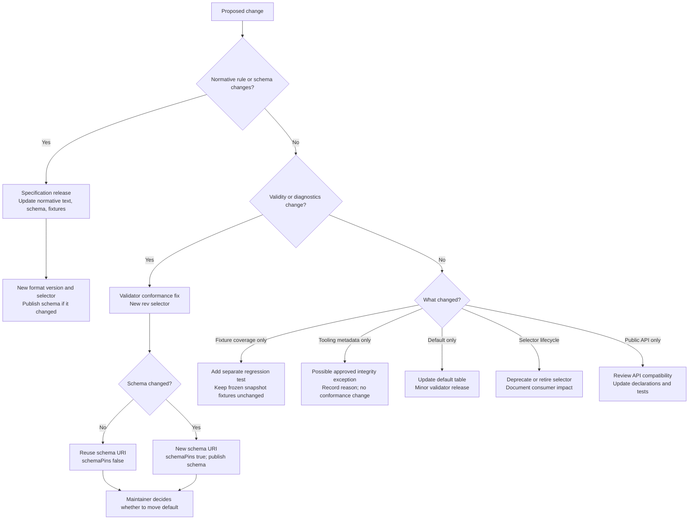

# Validator maintainer guide

How to ship a fix to `@mcpdesc/validator` behavior. For shared definitions, see
the [terminology guide](validator-terminology.md). For the configuration schema
and workflow, see the
[selector configuration design](validator-configuration-design.md). For
rationale and rejected options, see the
[snapshot design record](validator-snapshots.md).

> Validator `0.13.0` promotes the issue #24 revision selector and configured
> `0.8.0` default proven in `0.13.0-rc.1`. Stable selector `0.8.0` and RC.4
> remain available as deprecated explicit pins.

## Route a proposed change

Start by asking whether the change alters the validation contract: would a
document's validity or diagnostics change?



| Change type                                           | Where it goes                                                                                                                                                                                                                           | Main consequence                                                                                                          |
| ----------------------------------------------------- | --------------------------------------------------------------------------------------------------------------------------------------------------------------------------------------------------------------------------------------- | ------------------------------------------------------------------------------------------------------------------------- |
| **Normative rule or schema changes**                  | `mcpdesc-specification`: update the specification, canonical schema, and fixtures; create a new format release and selector. Import its bundle into `mcpdesc/core`.                                                                     | Authors may need to update `mcpdesc` and `$schema`; `@mcpdesc/core` operations need a support review.                     |
| **Validator result changes, specification unchanged** | Fix candidate validator behavior and regression fixtures; export and import a new `rev` selector.                                                                                                                                       | The old selector keeps its old result. Moving the default reaches unpinned documents, but explicit pins remain unchanged. |
| **Fixture expectation changes**                       | If the expected validity or diagnostics change, treat this as a conformance change and create a new `rev`. If adding coverage without changing expectations or validator results, add a separate validator regression test.             | Never edit fixtures inside a published snapshot: they are part of its integrity contract.                                 |
| **Tooling metadata only**                             | A maintainer may approve the narrow integrity exception for additive metadata that changes no schema, conformance, diagnostics, or fixtures. Record it in `snapshot-integrity.json` and the changelog.                                  | Requires explicit review; it is not a route for conformance fixes.                                                        |
| **Default changes, no snapshot changes**              | Update the maintainer-chosen `defaultSpecifications` entry and release in a minor validator version.                                                                                                                                    | Unpinned callers can see different results after upgrading; callers that pass a selector are unaffected.                  |
| **Selector deprecation or retirement**                | Update selector configuration, generated artifacts, package contents, support docs, and changelog. After confirming complete artifacts are committed to repository history, remove retired runtime and fixture directories from `HEAD`. | Consumers may need to migrate or pin an older npm release; in `0.x`, retirement may ship in a minor release.              |
| **Public API changes**                                | Review separately from snapshot changes; update types, browser and standalone entry points, tests, and migration notes.                                                                                                                 | Callers may need code changes even when validation semantics stay the same.                                               |

“Fixture-only” needs care: changing a fixture's expected result changes the
recorded conformance contract, even if no runtime code changes. Only adding a
test that confirms already-established behavior is test-only. The frozen fixture
corpus for an existing selector is never edited.

## Rules

- **Never modify a published snapshot.** Ship behavior changes as a new
  selector.
- **Selector shape:** `<major>.<minor>.<patch>[-<stage>.<number>]`, with stage
  `draft`, `rc`, or `rev`. A `rev` number is its cut date `YYYYMMDD`; cut at
  most one revision per release per date. Revisions are cumulative.
- **Defaults are a maintainer decision.** Make a revision the default when its
  fixes should reach unpinned documents, which is usually the case. Only stable
  or `rev` selectors can be defaults.
- **Default changes ship in minor releases**, with release notes listing the
  fixes.
- **No fallback.** A format version without a default fails with
  `unsupported-format-version`.
- **Caller-passed selectors are pins.** Their results never change.

## Ship a validator fix

### 1. Decide whether the JSON Schema changes

| Schema changes? | Schema URI                                                    | `schemaPins` |
| --------------- | ------------------------------------------------------------- | ------------ |
| No (typical)    | Reuse the release URI, for example `.../0.8.0.json`           | `false`      |
| Yes             | New URI, for example `.../0.8.0-rev.YYYYMMDD.json`, published | `true`       |

If the specification text itself must change, this is a specification release,
not a validator revision.

### 2. In `mcpdesc/mcpdesc-specification`

1. Fix the validation code.
2. Add or move fixtures so they capture the corrected behavior, plus regression
   cases.
3. Tag `v<release>-rev.YYYYMMDD`.
4. If the schema changed, publish it at its new URI with `$id` equal to the URL.
5. Export the bundle.

### 3. In `mcpdesc/core`

1. Import the bundle with the
   [`validator-snapshot-intake`](../.github/skills/validator-snapshot-intake/SKILL.md)
   skill:

   ```bash
   npm run import:snapshot --workspace @mcpdesc/validator -- --check <bundle>
   npm run import:snapshot --workspace @mcpdesc/validator -- <bundle>
   ```

2. Add its lifecycle, tag, schema URI, and format version to
   `packages/validator/config/selectors.yaml`; generate the runtime module and
   selector declaration, recording the importer-reported schema URI and digest;
   update the explicit npm `files` allowlist and `snapshot-integrity.json`.
   Generic package expectations and selector test matrices derive from the
   non-retired selectors automatically.
3. Update the format's `defaultSelector` if the revision becomes the default,
   and mark the previous selector deprecated.
4. Review `@mcpdesc/core` support for the selector, as described in
   [`AGENTS.md`](../AGENTS.md).
5. Write the release notes in `packages/validator/CHANGELOG.md`: the fixes, the
   default change, deprecations, retirements, and migration guidance.
6. Run `npm run check`.

### 4. Release

Follow [`RELEASING.md`](../RELEASING.md). Publish `<version>-rc.1` on `next`,
test it in the editor and the `mcpcontract` CLI, then publish the stable version
on `latest`.
