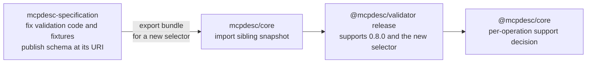

# Design: validator snapshots, revisions, and default selectors

This design record explains the terms used when changing `@mcpdesc/validator`
behavior, the options considered for fixing issue #24, and the decisions taken.
Shared terms are in the [validator terminology guide](validator-terminology.md).
For the short procedure, see the
[validator maintainer guide](validator-maintainer-guide.md). For the YAML
configuration proposal, see the
[selector configuration design](validator-configuration-design.md).

## Synthesis

**Status:** implemented in `@mcpdesc/validator@0.13.0`; the reviewed revision
bundle is active as the `0.8.0` format default after validation in
`0.13.0-rc.1`.

**Problem.** Issue [#24](https://github.com/mcpdesc/core/issues/24) is a
validator bug: the published `0.8.0` selector rejects `x-mcp-header` in Tool
schemas for MCP `2025-11-25`. The specification text is correct. Published
selectors are immutable, so the fix cannot change `0.8.0` itself.

**Decisions.**

1. The fix ships as a new immutable selector, `0.8.0-rev.20261021`. The
   specification repository fixes its validation code and fixtures and exports a
   bundle; the specification text and the `mcpdesc` format version do not
   change.
2. Every selector follows `<major>.<minor>.<patch>[-<stage>.<number>]`, where
   the stage is `draft`, `rc`, or `rev`. A `rev` number is its cut date
   `YYYYMMDD`. Revisions are cumulative.
3. The revision reuses `https://mcpdesc.org/schema/mcp-description/0.8.0.json`
   because its JSON Schema is unchanged. Nothing new is published.
4. Validator `0.13.0` adds maintainer-chosen default selectors per format
   version, `defaultSpecifications`, each with a `schemaPins` setting. Callers
   that do not pass a selector get the default; a passed selector is a pin.
5. A document whose format version has no default, such as `mcpdesc: "0.9.0"`
   today, fails explicitly. The validator never falls back to an earlier format
   version.
6. Validator `0.13.0-rc.1` introduced default selection and the revision as the
   default for `0.8.0`; stable `0.13.0` promotes that tested behavior on npm
   `latest`. The stable `0.8.0` selector is deprecated. RC.4 remains supported
   as deprecated because `@mcpdesc/core` still uses it; retiring it requires a
   coordinated core API review and release.
7. Not chosen: changing published selectors in place, a `0.8.1` format release
   for a validator-only fix, and silent fallback. A validator `1.0.0` release is
   deferred.

**Impact.**

| Who                                 | Effect of `0.13.0`                                          |
| ----------------------------------- | ----------------------------------------------------------- |
| Document authors                    | No change; `0.8.0` documents get the fix                    |
| Clients that do not pass a selector | Fix applied on upgrade; future defaults arrive the same way |
| Clients that pass a selector        | Results unchanged; they stop passing it to receive defaults |
| RC.4 users                          | RC.4 remains available but deprecated                       |

**Next steps.** Publish and verify stable validator `0.13.0`. Core selector
support remains unchanged until a separate operation-by-operation adoption
review is approved.

The rest of this document records the terminology, the reasoning, and the
rejected options.

## Repositories and packages

| Project                                                       | Owns                                                                                                                         | Typical change                                                                  |
| ------------------------------------------------------------- | ---------------------------------------------------------------------------------------------------------------------------- | ------------------------------------------------------------------------------- |
| `mcpdesc/mcpdesc-specification`                               | Normative specification text, canonical JSON Schemas, draft fixtures, and candidate validation code developed for a snapshot | Fix or develop validation logic and fixtures, then export an approved bundle    |
| `mcpdesc/core`                                                | The `@mcpdesc/validator` and `@mcpdesc/core` npm packages                                                                    | Import approved bundles, register selectors, test, document, and release        |
| `@mcpdesc/validator` (`packages/validator` in `mcpdesc/core`) | Executable conformance: answers whether a document is valid for an exact selector                                            | Add a sibling snapshot; never change a published one                            |
| `@mcpdesc/core` (`packages/core` in `mcpdesc/core`)           | Pure operations such as migration, projection, merge, declaration selection, and component reference resolution              | Decide, per operation, whether a new selector is supported; calls the validator |

`@mcpdesc/core` never copies validator rules. It calls `@mcpdesc/validator`.

## Format version and selector identity

Definitions for selector, snapshot, tag, fixture, and bundle are centralized in
the [terminology guide](validator-terminology.md). This section explains how a
format version, schema URI, and selector relate for issue #24.

A document carries two identity fields. Neither is the selector itself:

```json
{
  "$schema": "https://mcpdesc.org/schema/mcp-description/0.8.0.json",
  "mcpdesc": "0.8.0"
}
```

- `mcpdesc` is the **format version**. Many selectors share one format version:
  every 0.8 draft, release candidate, and the stable release use
  `mcpdesc: "0.8.0"`. In validator `0.13.0`, this selects the maintainer-chosen
  default only when the caller does not explicitly pin a selector.
- `$schema` is the **schema identity**: the `$id` of the snapshot's embedded
  JSON Schema. A unique `$schema` can pin a selector when `schemaPins` is true.
  When `schemaPins` is false, it identifies the format's schema and the
  validator uses the maintainer-chosen default instead.

| Selector             | `mcpdesc` | Schema URI (`$schema`)                                       | Specification tag     |
| -------------------- | --------- | ------------------------------------------------------------ | --------------------- |
| `0.8.0-rc.4`         | `0.8.0`   | `https://mcpdesc.org/schema/mcp-description/0.8.0-rc.4.json` | `v0.8.0-rc.4`         |
| `0.8.0`              | `0.8.0`   | `https://mcpdesc.org/schema/mcp-description/0.8.0.json`      | `v0.8.0`              |
| `0.8.0-rev.20261021` | `0.8.0`   | `https://mcpdesc.org/schema/mcp-description/0.8.0.json`      | `v0.8.0-rev.20261021` |

Drafts 1 to 3 shared `https://mcpdesc.org/schema/0.8.0.json`, so a document
could not identify which of them it targeted. A `rev` selector can intentionally
reuse its format's schema URI when its schema is unchanged and `schemaPins` is
false; in that case the URI floats to the configured default in `0.13.0`.

### How the selector is determined

In validator `0.12.0`, the selector is explicit in one of two ways:

1. **The caller passes it:**

   ```js

   ```

validateMcpDescription(document, { selector: '0.8.0' });

````

2. **The document declares it through `$schema`**, and the caller resolves it:

```js
const resolution = resolveMcpDescriptionSpecification(document);
// resolution.selector === '0.8.0'
````

`resolveMcpDescriptionSpecification` reports an unresolved result instead of
guessing when `$schema` is missing, unknown, shared by several active selectors
(`ambiguous-schema-identity`), or contradicts a caller-supplied selector
(`contradictory-snapshot-identity`). Default selection for unpinned documents is
planned in
[Planned: validator `0.13.0` with default selectors](#planned-validator-0130-with-default-selectors).

### Where selectors are published

| Place                                             | What it records                                                                  |
| ------------------------------------------------- | -------------------------------------------------------------------------------- |
| `mcpdesc/mcpdesc-specification` Git tag           | The specification snapshot, always `v<selector>`, for example `v0.8.0`           |
| Bundle `manifest.json`                            | The exact selector and snapshot tag handed to `mcpdesc/core`                     |
| Embedded `schema.json` `$id`                      | The schema URI documents put in `$schema`                                        |
| `@mcpdesc/validator` exports                      | `supportedSpecifications`, and `specificationProvenance` with tag, URI, and hash |
| `packages/validator/README.md` and `CHANGELOG.md` | Supported selectors and the validator release that first shipped each one        |

When `schemaPins` is true, give the selector a distinct schema URI so the
document can pin it. When `schemaPins` is false, selectors may intentionally
share a schema URI and the default table disambiguates them. Callers can always
pin any active selector through the validator API.

### Is publishing the schema at its URI required?

Not for `@mcpdesc/validator`: it embeds each selector's schema and never
downloads `$schema`. Validation works offline even if the URL is unreachable.

It is required for the wider ecosystem. Editors, JSON and YAML language servers,
and third-party validators fetch the `$schema` URL to provide completion and
validation. Existing selectors follow this practice: for example,
`https://mcpdesc.org/schema/mcp-description/0.8.0.json` serves the schema whose
`$id` is that same URL.

Therefore, when a new selector has a new schema URI, the specification release
must publish the schema at that URL before documents are told to use it. When a
selector reuses an existing schema URI, nothing new is published. External JSON
Schema tools continue to validate the unchanged schema; only
`@mcpdesc/validator` applies the new semantic behavior through its default
table. See [`schemaPins`](#schemapins).

## Why published snapshots are immutable

- **Reproducibility:** the same document and selector always produce the same
  result, regardless of which validator npm release is installed.
- **Safe upgrades:** consumers that validate with `0.8.0` in CI do not see
  pass/fail results change after an npm upgrade.
- **Visible behavior changes:** a behavior change requires a new selector, so
  consumers opt in explicitly.

The tradeoff: a behavior bug in a published snapshot remains in that snapshot.
Consumers receive the fix by moving to the new selector.

Only one exception exists: a maintainer may approve an additive tooling-metadata
correction to a published snapshot when its schema, conformance results,
diagnostics, and fixtures remain unchanged. Conformance bug fixes do not
qualify.

## Example: fixing a validator conformance bug

Issue [#24](https://github.com/mcpdesc/core/issues/24) reports that the
validator rejects `x-mcp-header` inside a Tool `inputSchema` for MCP
`2025-11-25`. That revision defines no semantics for the keyword, so it should
be preserved as an ordinary JSON Schema keyword and the document should be
valid. The specification text is correct; the validator implementation is not.

The `0.8.0` snapshot captures the bug in this fixture:

```text
packages/validator/test/snapshots/0.8.0/fixtures/expected-invalid/revision-inapplicable-mcp-header.json
```

```json
{
  "protocolVersions": ["2025-11-25"],
  "tools": [
    {
      "name": "early_header",
      "inputSchema": {
        "type": "object",
        "properties": {
          "region": { "type": "string", "x-mcp-header": "Region" }
        }
      }
    }
  ]
}
```

The code in `packages/validator/src/snapshots/0.8.0/base.js` emits
`field-not-supported-by-version` for every protocol revision other than
`2026-07-28` that uses `x-mcp-header`.



### 1. In `mcpdesc/mcpdesc-specification`

1. Fix the candidate validation code so MCP-specific `x-mcp-header` checks run
   only for protocol revisions that define the keyword (`2026-07-28`), and
   unknown or custom keywords are left to JSON Schema dialect validation.
2. Move the fixture above to `expected-valid/` and add the regression cases from
   the issue: arbitrary unknown and `x-*` keywords, invalid `x-mcp-header` usage
   for `2025-11-25` without an MCP-specific error, invalid token, type, and
   duplicate errors for `2026-07-28`, and multi-protocol documents.
3. Have a maintainer approve the new selector's identity. This guide uses `NEW`
   as a placeholder. See
   [Choosing the selector identity](#choosing-the-selector-identity) for the
   options, examples, and naming conventions.
4. If `NEW` has a new schema URI, publish its canonical schema at that URL, with
   `$id` equal to the URL.
5. Export the bundle for `NEW`.

### 2. In `mcpdesc/core`: import the snapshot

Follow the `validator-snapshot-intake` skill in
`.github/skills/validator-snapshot-intake/SKILL.md`:

```bash
# Verify the bundle without writing files.
npm run import:snapshot --workspace @mcpdesc/validator -- --check <bundle>

# Import after review and approval.
npm run import:snapshot --workspace @mcpdesc/validator -- <bundle>
```

This creates `src/snapshots/NEW/` and `test/snapshots/NEW/fixtures/`. The
existing `0.8.0` folders stay unchanged. Then update the runtime registry,
declarations, validator README and changelog, package-content checks, browser
selector lists, and integrity manifest. Run `npm run check`.

### 3. In `mcpdesc/core`: decide `@mcpdesc/core` support

If `@mcpdesc/core` will accept `NEW`, review every selector-sensitive operation
as described in `AGENTS.md`. Update the support matrix in
`packages/core/README.md` and
`packages/core/test/specification-support.test.ts`.

### 4. Release

A maintainer chooses the package versions and follows `RELEASING.md`. After the
release:

```js
validateMcpDescription(document, { selector: '0.8.0' }); // still invalid
validateMcpDescription(document, { selector: 'NEW' }); // valid
validateMcpDescription(document); // valid from validator 0.13.0: NEW is the default
```

## Choosing the selector identity

A corrected snapshot needs a selector, and usually a schema URI. Three options
exist. Each example shows the header a document author writes to get the issue
#24 fix.

**Decision for issue #24:** use a `rev` selector named as in option B, sharing
the base schema URI as in option C, because the schema is unchanged. Validator
`0.13.0` default selection removes option C's ambiguity; see
[Planned: validator `0.13.0` with default selectors](#planned-validator-0130-with-default-selectors).

### Option A: specification patch release `0.8.1`

The specification repository publishes a new format version, even though the
normative text is unchanged apart from release notes.

- Tag `v0.8.1` in `mcpdesc-specification`.
- Publish `https://mcpdesc.org/schema/mcp-description/0.8.1.json` with `mcpdesc`
  constrained to `"0.8.1"`.
- Selector: `0.8.1`.

```json
{
  "$schema": "https://mcpdesc.org/schema/mcp-description/0.8.1.json",
  "mcpdesc": "0.8.1"
}
```

```js
validateMcpDescription(document, { selector: '0.8.1' });
```

- **Pros:** plain `x.y.z` selector that the import script already accepts; the
  selector is explicit in the document.
- **Cons:** a new format version without a normative change; authors must edit
  two fields; tools that check `mcpdesc === "0.8.0"` reject the document; a
  `0.8.0` document and a `0.8.1` document become different format versions for
  `@mcpdesc/core` operations such as merge and migration.

### Option B: revision selector with its own schema URI

The format version stays `0.8.0`. The revised validation contract gets a unique
schema URI, as release candidates did.

- Tag `v0.8.0-rev.20261021` in `mcpdesc-specification`.
- Publish `https://mcpdesc.org/schema/mcp-description/0.8.0-rev.20261021.json`
  with `mcpdesc` still constrained to `"0.8.0"`.
- Selector: `0.8.0-rev.20261021`.

```json
{
  "$schema": "https://mcpdesc.org/schema/mcp-description/0.8.0-rev.20261021.json",
  "mcpdesc": "0.8.0"
}
```

```js
validateMcpDescription(document, { selector: '0.8.0-rev.20261021' });
```

- **Pros:** no new format version; `$schema` identifies and pins the revision.
- **Cons:** authors must update `$schema`; the URI must be hosted; external JSON
  Schema tools only see the schema, not validator-only semantic fixes.

### Option C: reuse the `0.8.0` schema URI

The new selector shares `https://mcpdesc.org/schema/mcp-description/0.8.0.json`.

```json
{
  "$schema": "https://mcpdesc.org/schema/mcp-description/0.8.0.json",
  "mcpdesc": "0.8.0"
}
```

```js
validateMcpDescription(document); // 0.13.0 uses the configured default
validateMcpDescription(document, { selector: '0.8.0' }); // pins old behavior
resolveMcpDescriptionSpecification(document); // resolves to the default revision
```

- **Pros:** documents do not change.
- **Cons:** `$schema` alone does not pin a revision; callers needing
  reproducible results must pass `specification` explicitly. Validator `0.12.0`
  does not know the new default, and external JSON Schema tools see no semantic
  behavior change because the schema itself is unchanged.

### Revision naming

Because the specification text is correct, a revision selector fits issue #24. A
revision selector is cumulative: each revision contains every fix made before
it. Name it by when it was cut, not by a single fix, and list the fixes in the
changelog.

Selectors appear in Git tags, directory names, URLs, and TypeScript types, so
use only letters, digits, `.`, and `-`.

#### `-` versus `+` in SemVer

| Separator | SemVer meaning                                    | Ordering                                                            |
| --------- | ------------------------------------------------- | ------------------------------------------------------------------- |
| `-`       | Pre-release identifiers, for example `0.8.0-rc.4` | Before the release: `0.8.0-rc.4` < `0.8.0`; compared field by field |
| `+`       | Build metadata, for example `0.8.0+rev.20261021`  | Ignored: `0.8.0+rev.20261021` has the same precedence as `0.8.0`    |

Within `-` identifiers, numeric fields compare numerically, so `rc.10` follows
`rc.9`. `+` metadata cannot order two revisions at all.

#### One selector rule

Every selector uses one shape:

```text
<major>.<minor>.<patch>[-<stage>.<number>]
```

| Stage    | Meaning                                    | Number              | Examples                          |
| -------- | ------------------------------------------ | ------------------- | --------------------------------- |
| _(none)_ | Stable format release                      | —                   | `0.8.0`                           |
| `draft`  | Working draft before release candidates    | Counter             | `0.8.0-draft.1` … `0.8.0-draft.4` |
| `rc`     | Release candidate                          | Counter             | `0.8.0-rc.1` … `0.8.0-rc.4`       |
| `rev`    | Corrected validation contract of a release | Cut date `YYYYMMDD` | `0.8.0-rev.20261021`              |

The existing `draft` and `rc` selectors already follow this shape; `rev` is the
only addition. Cut at most one revision per release per date. Use `-` rather
than `+` for consistency with them, because `-` fields order revisions, and
because `+` is decoded as a space by some static hosts and URL tooling.

The one exception to SemVer semantics: a strict SemVer sort places
`0.8.0-rev.20261021` before `0.8.0`, whereas a revision follows its release.
Selectors are matched as exact strings and never sorted as versions in
`@mcpdesc/validator`, so this does not affect validation. Document `rev`
selectors as stable revisions, not prereleases.

| Candidate                                     | Assessment                                                                                                       |
| --------------------------------------------- | ---------------------------------------------------------------------------------------------------------------- |
| `0.8.0-fix_x-mcp-header-for-2025-MCP-servers` | Describes one fix, so it misrepresents later cumulative revisions; long; `_` is not valid in a SemVer identifier |
| `0.8.0-rev2026_10_21`                         | `_` is not valid SemVer; missing `.` breaks the `-<stage>.<number>` shape                                        |
| `0.8.0-rev.20261021` (recommended)            | Follows the rule; dated; ordered numerically across revisions                                                    |
| `0.8.0-rev.1`                                 | Follows the rule with a counter like `draft` and `rc`, but carries no date                                       |
| `0.8.0+rev.20261021`                          | Breaks the rule; build metadata cannot order revisions; `+` is unsafe in some URLs                               |

Adopting `-rev.` selectors requires these `mcpdesc/core` changes:

- Extend the selector check in `packages/validator/scripts/import-snapshot.mjs`,
  which currently accepts only `x.y.z`, `x.y.z-draft.n`, and `x.y.z-rc.n`, to
  `^\d+\.\d+\.\d+(?:-(?:draft|rc|rev)\.\d+)?$`.
- Describe revision selectors in `packages/validator/README.md`, `AGENTS.md`,
  and the `validator-snapshot-intake` skill.

## Validator `0.13.0` with default selectors

**Status:** default-selection infrastructure and `0.8.0-rev.20261021` are
implemented in `@mcpdesc/validator@0.13.0` after validation in `0.13.0-rc.1`.
The revision is the configured default.

### Goal

Clients that do not choose a selector receive maintainer-approved validator
fixes when they install a newer validator release. Callers that pass a selector
keep exact, reproducible results. Published selectors stay immutable; only the
maintainer-defined defaults move.

### Selectors and defaults

| Validator release | Supported selectors                                                   | Default for `mcpdesc: "0.8.0"` |
| ----------------- | --------------------------------------------------------------------- | ------------------------------ |
| `0.12.0`          | `0.8.0-rc.4` (deprecated), `0.8.0`                                    | None; a selector is required   |
| `0.13.0-rc.1`     | `0.8.0-rc.4` (deprecated), `0.8.0` (deprecated), `0.8.0-rev.20261021` | `0.8.0-rev.20261021`           |
| `0.13.0`          | `0.8.0-rc.4` (deprecated), `0.8.0` (deprecated), `0.8.0-rev.20261021` | `0.8.0-rev.20261021`           |

RC.4 stays available as a deprecated selector because `@mcpdesc/core` currently
depends on it. Retirement is deferred to a coordinated core compatibility
decision; users can still pin RC.4 explicitly in `0.13.0`.

The validator exports the defaults as a table the maintainer edits:

```js
export const defaultSpecifications = Object.freeze({
  '0.8.0': Object.freeze({
    selector: '0.8.0-rev.20261021',
    schemaPins: false,
  }),
});
```

Rules for the table:

- **The maintainer chooses each default.** The default is not automatically the
  newest selector. A new revision becomes the default when its fixes are worth
  applying to unpinned documents, which is usually the case.
- **Only stable releases and `rev` selectors can be defaults**, never `draft` or
  `rc` selectors.
- **No entry means no validation.** A document whose `mcpdesc` has no entry,
  such as `"0.9.0"` before a release adds one, fails with
  `unsupported-format-version`. The validator never falls back to an earlier
  format version; users wait for a validator release that supports theirs.
- **Changes ship in minor releases** with release notes that list the fixes,
  never in patch releases.

### `schemaPins`

Each default entry declares whether a document's `$schema` pins a selector:

- **`schemaPins: false` (typical).** The revision changes validation code and
  fixtures, not the JSON Schema. The revision reuses the base schema URI
  `https://mcpdesc.org/schema/mcp-description/0.8.0.json` with identical schema
  content, so nothing new is published. Every document of that format version
  uses the default, whether or not it declares `$schema`. Documents and external
  tools do not change. The issue #24 revision uses this setting.
- **`schemaPins: true`.** The revision also changes the JSON Schema. It gets its
  own URI, for example
  `https://mcpdesc.org/schema/mcp-description/0.8.0-rev.20270115.json`,
  published at that URL. Documents without `$schema` use the default. Documents
  that declare an older URI keep the selector that URI names, so a schema change
  never reaches them silently; their authors opt in by updating `$schema`.

Set `schemaPins: true` whenever the default's schema differs from the schema at
any URI that documents of that format version may declare.

### Resolution order

`resolveMcpDescriptionSpecification`, and `validateMcpDescription` when called
without a selector, choose the selector as follows:

1. **The caller passes `specification`:** use it exactly. This is a pin.
2. **Read `mcpdesc`:** if `defaultSpecifications` has no entry, fail with
   `unsupported-format-version`.
3. **`$schema` is present:**
   - If it does not belong to that format version, fail with
     `contradictory-snapshot-identity`; if it is not recognized, fail with an
     unknown-identity error.
   - If the entry has `schemaPins: true`, use the selector that `$schema` names.
   - Otherwise, use the default.
4. **`$schema` is absent:** use the default.

To keep floating documents valid after a selector retires, the validator keeps a
registry of every schema URI it has shipped, mapped to its format version,
including retired ones. `draft` and `rc` URIs never resolve to a default.

| Document                          | `0.12.0`                    | `0.13.0`                                   |
| --------------------------------- | --------------------------- | ------------------------------------------ |
| `$schema` is the `0.8.0` URI      | `0.8.0`                     | `0.8.0-rev.20261021` (`schemaPins: false`) |
| No `$schema`, `mcpdesc: "0.8.0"`  | `missing-snapshot-identity` | `0.8.0-rev.20261021`                       |
| `$schema` is the `0.8.0-rc.4` URI | `0.8.0-rc.4`                | `0.8.0-rev.20261021` (`schemaPins: false`) |
| `mcpdesc: "0.9.0"`                | Structural errors           | `unsupported-format-version`               |
| Caller passes `selector: '0.8.0'` | `0.8.0`                     | `0.8.0`, deprecated                        |

### Public API changes

- `validateMcpDescription(document, options?)`: `options.selector` becomes
  optional. `options.specification` remains a compatibility alias.
- Validation and resolution results add `selector`, the selector actually used,
  and `defaulted`, which is `true` when the selector came from
  `defaultSpecifications`. Defaulting adds no diagnostic, because many CI setups
  fail on warnings.
- Results retain `specification` as a compatibility alias for `selector`.
- New export: `defaultSpecifications`.
- New failure: `unsupported-format-version`.

### Effects on existing clients

| Change                                             | Effect                                                                                                                                                    |
| -------------------------------------------------- | --------------------------------------------------------------------------------------------------------------------------------------------------------- |
| `options.selector` becomes optional                | None for callers that pass it. Existing `options.specification` calls remain supported as an alias.                                                       |
| New result fields                                  | Additive. Code that deep-compares whole result objects must be updated.                                                                                   |
| Resolution returns the default for the `0.8.0` URI | Intended upgrade. Code that compares the resolved selector with `'0.8.0'`, or relies on `missing-snapshot-identity` to prompt users, behaves differently. |
| Explicit selectors are pins                        | Clients that pass `selector: doc.mcpdesc` or a hard-coded `'0.8.0'` get no automatic upgrade. They must stop passing a selector to benefit.               |
| RC.4 remains deprecated                            | RC.4 continues to work in `0.13.0`; retirement is deferred to a coordinated `@mcpdesc/core` support change.                                               |

### Recommendations for validator clients

The editor and the `mcpcontract` CLI should:

- call `validateMcpDescription(document)` without a selector by default;
- show `result.specification`, and indicate when `result.defaulted` is `true`;
- offer an explicit pin, for example a CLI `--specification` option, for users
  who need reproducible CI results; and
- follow the packaged `MIGRATING-0.13.md` guide when upgrading from 0.12.x.

### Versioning

Validator `0.13.0` remains in `0.x`, where minor releases may change public
behavior:

- **Minor releases:** add selectors and revisions, change a default, retire
  selectors, or change the API. Release notes list every default change and its
  fixes, because a default change can turn a passing unpinned document into a
  failing one.
- **Patch releases:** fixes that change no selector's results and no default.

A validator `1.0.0` release is deferred. When it happens, retiring an active
selector becomes a breaking change that requires a major release.

### Release notes for the revision candidate

```markdown
### Added

- Immutable `0.8.0-rev.20261021` selector. It fixes issue #24: unknown and
  custom keywords in embedded Tool schemas are preserved, and MCP-specific
  `x-mcp-header` checks apply only to MCP `2026-07-28`.
- `defaultSpecifications`: the maintainer-chosen default selector for each
  supported format version, with its `schemaPins` setting.
- `selector`, the compatibility alias `specification`, and `defaulted` in
  validation and resolution results.

### Changed

- `options.selector` is optional. Without it, the validator uses the default
  selector for the document's `mcpdesc` version.
- Documents declaring `https://mcpdesc.org/schema/mcp-description/0.8.0.json`,
  or no `$schema`, now validate with `0.8.0-rev.20261021`.
- `0.8.0` is deprecated. Pass `selector: '0.8.0'` to keep its results.
- Documents with an unsupported `mcpdesc` version fail with
  `unsupported-format-version`; no earlier version is used instead.

### Deprecated

- Stable selector `0.8.0`; pass `specification: '0.8.0'` to keep its original
  validation results. RC.4 remains supported but deprecated for compatibility
  with `@mcpdesc/core`.

### Migration

- To receive future fixes automatically, stop passing a selector derived from
  `mcpdesc` or hard-coded to `'0.8.0'`.
- To keep reproducible results, pass `selector` explicitly.
- Update code that compares whole result objects or expects resolution to fail
  for documents without `$schema`.
```

### Required policy and code changes

- Update `packages/validator/AGENTS.md`, `AGENTS.md`, and
  `.github/copilot-instructions.md`, which forbid inferring a selector from the
  `mcpdesc` format version alone.
- Update `packages/validator/README.md`, `CONTRIBUTING.md`, and `ROADMAP.md`.
- Implement `defaultSpecifications`, the schema URI registry, the resolution
  order, the result fields, and `unsupported-format-version`, with tests and
  declarations for the default, browser, and standalone entries.
- Accept `rev` selectors in `packages/validator/scripts/import-snapshot.mjs`,
  and allow a `rev` snapshot to declare its base release's schema URI.
- Review `@mcpdesc/core` operations for the revision and for default selection,
  including whether migration from 0.7.0 should target the default.

## Alternative policy

The project could instead allow conformance fixes to change a published selector
in a new npm release. That would deliver this fix under `0.8.0`: documents and
clients would need no change beyond upgrading `@mcpdesc/validator`, and no new
selector or schema URI would be published.

It was not chosen because:

- **Results would depend on two versions.** The same document and selector could
  pass with one validator release and fail with another. Reproducing a result
  would require the selector and the exact npm version.
- **Tools could disagree.** The editor and the `mcpcontract` CLI may ship
  different validator releases, so they could report different results for the
  same document and selector.
- **Changes would not be opt-in.** Some fixes make validation stricter. Under
  this policy, a previously valid document could start failing in CI after a
  routine dependency update, without any change to the document.
- **A selector would stop naming one contract.** Claims such as "valid against
  `0.8.0`" would become ambiguous, and `specificationProvenance` would no longer
  identify a single behavior.
- **Integrity checks would be weakened.** Frozen fixtures and
  `snapshot-integrity.json` exist to detect changes to published behavior. They
  would have to accept edits to published snapshots.
- **Hosted schemas could drift.** If a fix also changed the schema, the content
  served at an existing `$schema` URL would change under the same `$id`, and
  external tools that cache it would disagree.
- **It breaks a stated promise.** The validator README states that the exact
  selector is required so validation never changes when a later draft is
  published.

Adopting that policy would require updating `AGENTS.md`,
`packages/validator/AGENTS.md`, `packages/validator/README.md`,
`CONTRIBUTING.md`, and this guide.

Validator `0.13.0` takes a narrower path: selectors stay immutable and only
maintainer-defined defaults move. Callers that pass a selector keep every
guarantee above; unpinned documents receive fixes by design.
